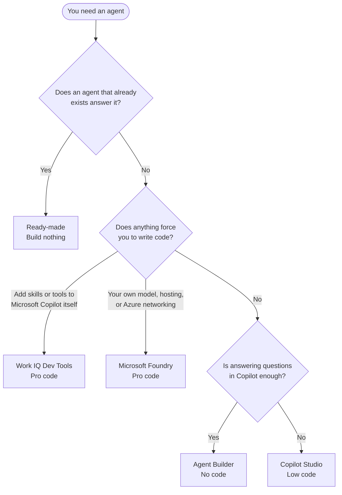

---
authors:
  - title: Luke Mao
    url: https://www.ssw.com.au/people/luke-mao
  - title: Jim Zheng
    url: https://www.ssw.com.au/people/jim-zheng
created: 2026-09-09T00:00:00.000Z
createdBy: Luke Mao
createdByEmail: LukeMao@ssw.com.au
guid: 88c76a84-da63-466b-b749-2a3092d479d6
isArchived: false
lastUpdated: 2026-09-09T00:00:00.000Z
lastUpdatedBy: Luke Mao
lastUpdatedByEmail: LukeMao@ssw.com.au
redirects:
  - bot-framework
related:
  - rule: public/uploads/rules/dataverse-ai-options/rule.mdx
seoDescription: Ready-made, no-code, low-code, and pro-code. Compare Agent Builder,
  Copilot Studio, Work IQ Dev Tools, the Microsoft 365 Agents SDK, and Microsoft Foundry
  to pick the right platform for your chatbot or AI agent.
title: Do you choose the right platform for your AI agent?
categories:
  - category: categories/software-engineering/rules-to-better-bots.mdx
type: rule
uri: ai-agent-platform
---

Your team spends months coding a chatbot from scratch: hosting it, making it search your documents, and checking who's allowed to see what. On Microsoft 365, start with Copilot Studio instead. Searching your documents, signing people in, taking actions, and publishing to Teams all come built in.

<youtubeEmbed url="https://www.youtube.com/watch?v=VN3xpj1_K6A" description={"Video: SophieBot - Your Company Knowledge, All in One Chat by Levi Jackson (2 min)"} />

<endIntro />

## Why Copilot Studio?

It's low-code, so you don't write the hard parts:

* **Knowledge** - [Search your documents](https://learn.microsoft.com/en-us/microsoft-copilot-studio/knowledge-copilot-studio) in SharePoint, websites, and files
* **Actions** - Look up live data or book a room, not just answer questions
* **Channels** - [Publish to Teams, Microsoft 365 Copilot, or a website](https://learn.microsoft.com/en-us/microsoft-copilot-studio/publication-fundamentals-publish-channels)
* **Testing** - Try changes before they go live

[SSW's SophieBot is a real example](https://www.ssw.com.au/products/sophiebot). The first version was hand-coded in C#. SSW rebuilt it in Copilot Studio, and it now answers staff questions in Teams from the SSW website, SSW Rules, SharePoint, and CRM, and looks up live data like who is in the office.

## When should you pick something else?

Go simpler when answering questions inside Copilot is enough. Only write code when something forces you to.

| Tier | Tool | What it is |
| --- | --- | --- |
| Ready-made | Copilot in SharePoint, Word, Excel, and PowerPoint, and ready-made agents in Copilot | Already there with a Microsoft 365 Copilot licence. Try it before you build anything |
| No-code | Agent Builder | Describe an agent in plain English inside Copilot. Not available in Teams chats |
| Low-code | Copilot Studio | The default. Agents with knowledge, actions, and workflows, for Teams, websites, and more |
| Pro-code | Work IQ Dev Tools (or Agents Toolkit) | Add skills or tools to Microsoft Copilot from code |
| Pro-code | Microsoft 365 Agents SDK | Bot Framework's successor. Connects an app you built to a Copilot Studio or Foundry agent |
| Pro-code | Microsoft Foundry | Build on Azure with your own models, hosting, and networking |

## What if you are not a Microsoft shop?

Pick the platform where your documents and user accounts already live.

| Your content mostly lives in | Look at |
| --- | --- |
| Microsoft 365, SharePoint, Dataverse | The tree above |
| Google Workspace or Google Cloud | Gemini Enterprise Agent Platform |
| AWS | Amazon Bedrock AgentCore |
| Salesforce | Agentforce |
| Nowhere in particular | A code-first SDK such as the OpenAI Agents SDK or LangGraph |

***

### Learn more

* [Choose between Agent Builder and Copilot Studio](https://learn.microsoft.com/en-us/microsoft-365/copilot/extensibility/copilot-studio-experience) - Microsoft's decision guide
* [Choose development tools for your Copilot plugin](https://learn.microsoft.com/en-us/plugins/choose-plugin-development-tools) - Work IQ Dev Tools, Agents Toolkit, and SDKs
* [SSW: Do you know your Dataverse AI options?](/dataverse-ai-options) - Copilot Studio agents and MCP against Dataverse
