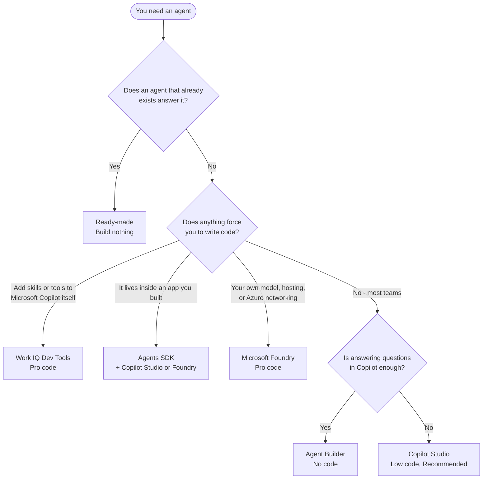

---
authors:
  - title: Luke Mao
    url: https://www.ssw.com.au/people/luke-mao
created: 2026-09-09T00:00:00.000Z
createdBy: Luke Mao
createdByEmail: LukeMao@ssw.com.au
guid: 88c76a84-da63-466b-b749-2a3092d479d6
isArchived: false
lastUpdated: 2026-09-09T00:00:00.000Z
lastUpdatedBy: Luke Mao
lastUpdatedByEmail: LukeMao@ssw.com.au
redirects:
  - bot-framework
related:
  - rule: public/uploads/rules/dataverse-ai-options/rule.mdx
seoDescription: Ready-made, no-code, low-code, and pro-code. Compare Agent Builder,
  Copilot Studio, the Agents Toolkit, the Microsoft 365 Agents SDK, and Microsoft Foundry
  to pick the right platform for your chatbot or AI agent.
title: Do you choose the right platform for your AI agent?
categories:
  - category: categories/software-engineering/rules-to-better-bots.mdx
type: rule
uri: ai-agent-platform
---

You need an agent that answers staff questions from the HR policies in SharePoint. You build one in Copilot Studio, point it at the HR site, and ship it a fortnight later.

That site probably already had an agent. Unless an admin has switched it off, staff with a Microsoft 365 Copilot licence can ask Copilot in SharePoint about that site's content on day one.

Microsoft offers four tiers, and most teams start further down than they need to.

<endIntro />

## Which one should you use?

Four tiers, from an agent that already exists to one you host yourself.

| Tier | Tool | Publishes to |
| --- | --- | --- |
| Ready-made | Copilot in SharePoint where available, Copilot in Word, Excel, and PowerPoint, and ready-made agents under Plugins | Wherever that app already is |
| No-code | Agent Builder | Microsoft 365 Copilot (not Teams chats) |
| Low-code | Copilot Studio (Recommended) | Teams, web, WhatsApp, Slack, SMS, and more |
| Pro-code | Work IQ Dev Tools, or Agents Toolkit for lower-level control | Microsoft 365 Copilot, Teams |
| Pro-code | Microsoft 365 Agents SDK | Any surface you code |
| Pro-code | Microsoft Foundry | Teams, Microsoft 365 Copilot, or any app via its endpoint |

Work down the tree and stop at the first thing that fits.

Most teams that need more than Agent Builder should stop at Copilot Studio. The common failure is not picking a weak tool, it is reaching for a powerful one before anyone has proven the agent gets used.

<boxEmbed style="info" figurePrefix="none" figure="" body={<>

**Note:** A SharePoint agent is not a separate platform. Where [Copilot in SharePoint](https://learn.microsoft.com/en-us/sharepoint/upgrade-sharepoint-agents) is available, licensed users can already ask about the current site's content. Use Agent Builder when you need custom Q&A over selected SharePoint content.

</>} />

## Why is Copilot Studio the default?

Because it is a finished product rather than a toolkit. [Knowledge](https://learn.microsoft.com/en-us/microsoft-copilot-studio/knowledge-copilot-studio) from SharePoint, Dataverse, documents, and Microsoft Copilot connectors without code. Generative answers on by default. File uploads, a [long list of channels](https://learn.microsoft.com/en-us/microsoft-copilot-studio/publication-fundamentals-publish-channels), and real dev, test, and production environments.

For signed-in users, SharePoint and Dataverse answers are trimmed to what each person's Entra ID account can already open. Two exceptions: [files uploaded straight into the agent](https://learn.microsoft.com/en-us/microsoft-copilot-studio/knowledge-add-unstructured-data) can answer anyone who can use it, and a Copilot connector set to ["Visible to everyone"](https://learn.microsoft.com/en-us/microsoft-365/copilot/connectors/manage-access-permissions) shares its content with the whole organisation.

Capabilities decide this, not audience size. Choose it when the agent needs actions, workflows, Teams chats or a website, or real dev, test, and production environments.

SSW's own SophieBot is an example. The first version was custom C# on Bot Framework and LUIS. SSW rebuilt it in Copilot Studio, and it now answers staff questions in Teams from the SSW website, SSW Rules, SharePoint, and CRM, and calls Azure Functions for live data like who is in the office.

<youtubeEmbed url="https://www.youtube.com/watch?v=VN3xpj1_K6A" description={"Video: SophieBot: Your Company Knowledge, All in One Chat | Levi Jackson (2 min)"} />

## When do you need pro-code?

The Microsoft 365 Agents SDK is the successor to the Bot Framework SDK, whose support ended on 31 December 2025, and it inherits that job: move messages between a user and whatever logic you wrote. [Microsoft is blunt](https://learn.microsoft.com/en-us/microsoft-365/agents-sdk/agents-sdk-overview) that it is not an AI model, not an orchestration engine, and not a no-code builder.

Picking it instead of Copilot Studio means building generative answers, grounding, and security trimming yourself. It ships a [Copilot Studio client](https://learn.microsoft.com/en-us/microsoft-365/agents-sdk/integrate-with-mcs) for .NET, JavaScript, and Python, so put Copilot Studio or Foundry behind it rather than in place of them.

<boxEmbed style="warning" figurePrefix="none" figure="" body={<>

**Warning:** Foundry's [SharePoint tool](https://learn.microsoft.com/en-us/azure/foundry/agents/how-to/tools/sharepoint) is in preview. It uses the signed-in user's SharePoint permissions and is unavailable when the agent is published to Teams. Each end user needs the **Foundry User** role on the project. For licensing, use Microsoft 365 Copilot licences or enable pay-as-you-go billing.

</>} />

## What if you are not a Microsoft shop?

Grounding and per-user permission trimming only work where your content and your identity provider already live, so the platform follows the data.

| Your content mostly lives in | Look at |
| --- | --- |
| Microsoft 365, SharePoint, Dataverse | Copilot Studio |
| Google Workspace or Google Cloud | Gemini Enterprise Agent Platform |
| AWS | Amazon Bedrock AgentCore |
| Salesforce | Agentforce |
| Nowhere in particular | A code-first SDK such as the OpenAI Agents SDK or LangGraph |

<boxEmbed style="info" figurePrefix="none" figure="" body={<>

**Note:** Choose for where your data lives, not for the authoring experience. OpenAI shipped a visual Agent Builder in October 2025 and [deprecated it eight months later](https://developers.openai.com/api/docs/deprecations), with shutdown set for 30 November 2026 and OpenAI's Agents SDK as the way out. Drag-and-drop canvases come and go. The grounding layer is what you are really committing to.

</>} />

***

### Learn more

* [Choose between Agent Builder and Copilot Studio](https://learn.microsoft.com/en-us/microsoft-365/copilot/extensibility/copilot-studio-experience) - Microsoft's decision guide by capabilities, publishing, and lifecycle needs
* [Choose development tools for your Copilot plugin](https://learn.microsoft.com/en-us/plugins/choose-plugin-development-tools) - Microsoft's guidance on Work IQ Dev Tools, Agents Toolkit, and related authoring options
* [SSW: Do you know your Dataverse AI options?](/dataverse-ai-options) - Copilot Studio agents and MCP against Dataverse
