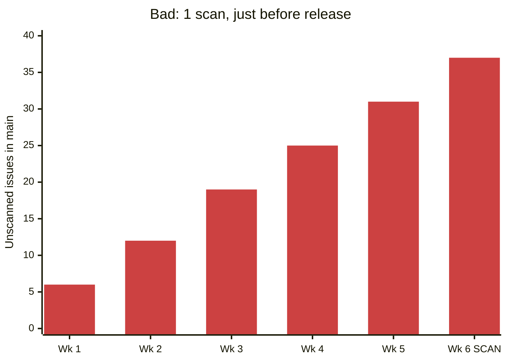
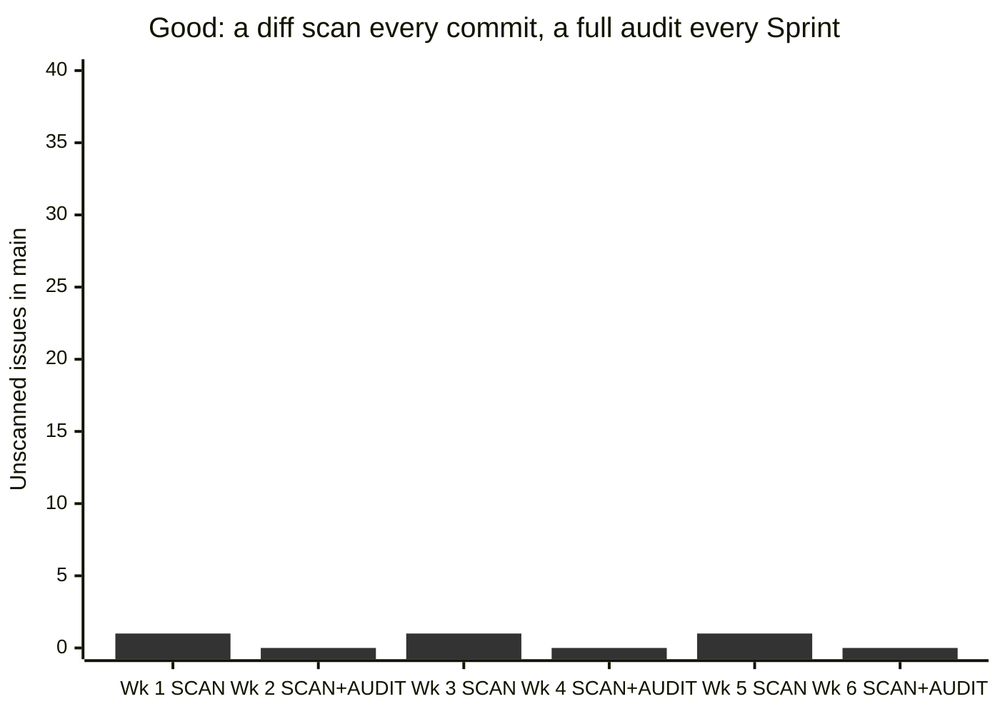

AI has changed how fast developers ship. Your AI agent can build a feature in an afternoon, and in one week a bunch of agents can generate more code than a single developer could review in their lifetime.

With agents generating so many features, it's not always feasible to read every line yourself. This doesn't mean you have to stop caring about security though. AI is particularly good at re-running something over and over again. This makes it perfect at catching security vulnerabilities when it knows what to look for.

Make running AI security scans part of your daily workflow. Scan your diff on every commit, so you catch the issue while the fix is still a 2-line change, not a post-merge incident. Then audit the whole app every Sprint.

<endIntro />

## Why do you need a security scan when AI writes the code?

AI writes code that works, not necessarily code that's safe. This doesn't mean that AI is the enemy but you should treat every PR as guilty until proven innocent.

[Veracode's October 2026 GenAI Code Security update](https://veracode.com/press-release/veracode-finds-first-meaningful-gain-in-ai-code-security-since-2025-as-average-pass-rate-hits-62) found 38% of AI coding tasks still produced vulnerable code. That's better than 45% in 2025, but even the best models, Claude Opus 5.5 and GPT-6-Sol, failed 1 in 4 security tasks.

<imageEmbed alt="Chart of security and syntax pass rates of LLMs by release date" size="large" showBorder={false} figurePrefix="none" figure="Security and Syntax Pass Rates vs LLM Release Date (Veracode security article)" src="/uploads/rules/ai-security-scans/GenAI-Coding-Report-Graph.avif" />

Some common flaws when vibe-coding:

* **Broken access control**: An endpoint trusts an ID from the client instead of checking who owns the record
* **Injection**: SQL built with string concatenation, or user input dropped into `dangerouslySetInnerHTML`
* **Hard-coded secrets**: An API key pasted in "just to test it", then committed
* **Risky dependencies**: A package version the AI suggested that has a known CVE, which the [OWASP Secure Coding with AI Cheat Sheet](https://cheatsheetseries.owasp.org/cheatsheets/Secure_Coding_with_AI_Cheat_Sheet.html) tells you to audit

A human review still matters, but a reviewer reading a 1k+ line PR will easily skim over certain security issues. This is another reason why pulling down the changes and testing locally is still an important step for catching issues.

## When should you run an AI security scan?

You should be running security scans throughout the whole development process. Scans are cheap, fixing incidents is not.

Use 2 kinds of scan. They complement each other because they look at different things:

* **Diff scan, every commit** - Claude Code's `/security-review` checks only what you've changed, so it's fast enough to run every time
* **Whole-app audit, every Sprint** - Cloudflare's security-audit skill maps the entire app and its trust boundaries, so it finds the flaws no single diff shows, like 2 safe-looking changes that are unsafe together



**Figure: Bad example - No scans for 5 weeks, so issues pile up in main. The only scan finds all 37 at once, right before you ship**



**Figure: Good example - Every commit is scanned, so issues get fixed on the branch. The Sprint audit catches what the diff scans missed, so main stays close to zero**

## How do you scan every commit?

### Claude Code (Recommended)

Claude comes pre-built with security scanning tools. Before each commit, run the following command in Claude Code on your feature branch:

```text
/security-review
```

Claude will review all pending changes on the branch, looking for common attack vectors such as SQL injections, XSS, authentication and authorisation flaws, insecure data handling, and vulnerable dependencies. When it finds something, ask it to fix it in the same session. See [Automated security reviews in Claude Code](https://support.claude.com/en/articles/11932705-automated-security-reviews-in-claude-code).

We also encourage using Anthropic's AI security reviewer. You can add this to your GitHub repository workflow [anthropics/claude-code-security-review](https://github.com/anthropics/claude-code-security-review)

### OpenAI Codex

Unlike Claude, Codex requires a plugin to conduct security scans. Install the Codex Security plugin using the command below, then ask Codex to review your branch before each commit.

```text
Use $codex-security:security-diff-scan to review the changes from origin/main to HEAD for security regressions.
```

It'll review each changed file plus the code paths that flow in and out from the change, without turning into a full repository audit. You can also run it from **Security** -> **Scans** in the Codex desktop app. See [Review code changes for security](https://developers.openai.com/codex/security/plugin/code-changes).

### GitHub Copilot

Copilot CLI has its own `/security-review` command that scans your local changes before you commit. It's currently an experimental feature in public preview, so make sure to turn on experimental mode first. See the [GitHub changelog](https://github.blog/changelog/2026-06-10-dedicated-security-review-command-now-available-in-copilot-cli/).

<boxEmbed
  body={<>
    **Tip:** Back up the local scan with a PR check, so a skipped scan still gets caught. The [claude-code-security-review GitHub Action](https://github.com/anthropics/claude-code-security-review) runs the same analysis on every PR and comments inline. Pin it to a commit SHA, not `@main`.
  </>}
  figurePrefix="none"
  figure=""
  style="tips"
/>

<boxEmbed
  body={<>
    **Only run the PR Action on trusted PRs.** Its README warns it is not hardened against prompt injection. A PR from a fork can hide instructions in a comment that tell the reviewer to approve it. Require approval before workflows run for outside contributors. See [Do you stop pwn requests from running with your GitHub secrets?](/stop-pwn-requests-github-secrets)
  </>}
  figurePrefix="none"
  figure=""
  style="warning"
/>

## How do you audit the whole app?

A diff scan can't see how your changes fit with the rest of the app. Once a Sprint, or every week on a busy repo, run Cloudflare's open-source [security-audit skill](https://github.com/cloudflare/security-audit-skill) over the whole codebase.

Install it:

```bash
npx skills add https://github.com/cloudflare/security-audit-skill --skill security-audit
```

Then ask your AI Agent:

```text
security audit this codebase
```

It maps the architecture and trust boundaries, sends isolated sub-agents to hunt for bugs, then has fresh agents try to disprove every finding. The report only keeps the findings that survive. Add them to your backlog as PBIs.

Runs build on each other. Cloudflare found a single run catches roughly half of what repeated runs find, which is why it belongs on a regular schedule, not a one-off.

<boxEmbed
  body={<>
    **Run it in a sandbox.** To prove a finding, the skill wants to build and run your code. It needs an OS-level sandbox with no network access to do that safely. Without one, it marks the finding `needs_validation` instead of running anything.
  </>}
  figurePrefix="none"
  figure=""
  style="warning"
/>

## Which tool catches what?

No single tool covers everything. That's why it's so important to layer them.

| Tool                                                                                                                                        | When it runs  | What it's best at                                                                                                           |
| ------------------------------------------------------------------------------------------------------------------------------------------- | ------------- | --------------------------------------------------------------------------------------------------------------------------- |
| Claude Code `/security-review` (Recommended)                                                                                                | Every commit  | Injection, XSS, auth flaws, insecure data handling and vulnerable dependencies in your diff, with fixes in the same session |
| Codex Security `security-diff-scan`                                                                                                         | Every commit  | The same diff check for teams on Codex                                                                                      |
| Copilot CLI `/security-review` (preview)                                                                                                    | Every commit  | The same diff check for teams on Copilot                                                                                    |
| Cloudflare security-audit skill (Recommended)                                                                                               | Every Sprint  | Whole-app flaws across trust boundaries that no single diff shows                                                           |
| claude-code-security-review Action                                                                                                          | On every PR   | Safety net when someone skips the local scan                                                                                |
| GitHub code scanning + [Copilot Autofix](https://docs.github.com/en/code-security/concepts/code-scanning/copilot-autofix-for-code-scanning) | On every PR   | Known vulnerability patterns, with a suggested fix                                                                          |
| GitHub secret scanning push protection                                                                                                      | At `git push` | Blocks the push when it detects a secret                                                                                    |

<boxEmbed
  body={<>
    An AI scan complements human review and [Penetration Testing](/penetration-testing). It doesn't replace them. Anthropic says the same about its own tool.
  </>}
  figurePrefix="none"
  figure=""
  style="info"
/>

***

### Learn more

* [SSW: Do you use the right cybersecurity tools when writing code?](/developer-cybersecurity-tools) - The non-AI scanners to run alongside this
* [SSW: Do you defend against package supply chain attacks?](/defend-against-package-supply-chain-attacks) - Lockfiles, release-age windows and install scripts
* [Anthropic - Automate security reviews with Claude Code](https://claude.com/blog/automate-security-reviews-with-claude-code) - Why the command exists and what it looks for
* [Cloudflare - Build your own vulnerability harness](https://blog.cloudflare.com/build-your-own-vulnerability-harness) - How the security-audit skill grew into Cloudflare's own vulnerability discovery system
* [OWASP - Secure Coding with AI Cheat Sheet](https://cheatsheetseries.owasp.org/cheatsheets/Secure_Coding_with_AI_Cheat_Sheet.html) - Threats specific to AI Agents that run commands and push code
* [Veracode - October 2026 GenAI Code Security update](https://veracode.com/press-release/veracode-finds-first-meaningful-gain-in-ai-code-security-since-2025-as-average-pass-rate-hits-62) - The latest numbers, including the per-model leaderboard
