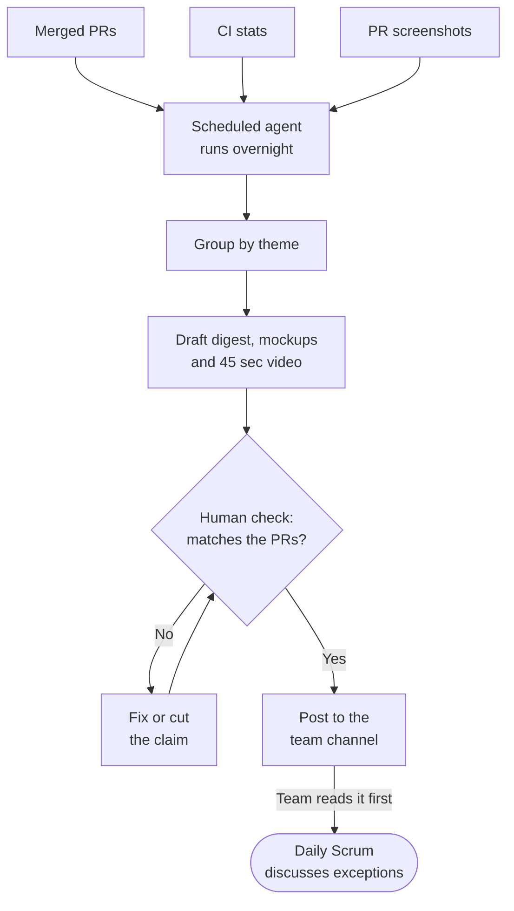

When your team merges more PRs than it can talk through, the Daily Scrum can become a status list. A failed deployment or open decision gets lost among completed changes.

Post a short, visual "what happened yesterday" digest before the meeting: changes grouped by theme, exceptions first, and every claim linked to evidence. Then use the Daily Scrum for what needs the team.

<endIntro />



**Figure: An overnight agent drafts the digest, and a person checks it before the team reads it**

## Group yesterday by theme, exceptions first

All Northwind figures, counts, identifiers and timings below use **example data**. A raw list makes readers reconstruct the day:

<boxEmbed
  style="greybox"
  body={<>
    **Yesterday's changes (27 PRs)**

    ```text
    $ git log --oneline --merges --since=yesterday
    c41e9a2 Merge PR #1430 order-notes-field
    b77d0f3 Merge PR #1426 bump-dependencies
    a9c3e11 Merge PR #1425 orders-api-retry
    9f2b7c4 Merge PR #1424 revert-1418
    8e1a5d0 Merge PR #1423 sales-region-date-range
    7d4c2b9 Merge PR #1421 fix-flaky-order-test
    6c9e8f1 Merge PR #1420 orders-search-migration
    5b3a7e2 Merge PR #1419 ship-date-picker
    4a2f6d3 Merge PR #1418 orders-bulk-export
    3f1e5c4 Merge PR #1417 refactor-orders-grid
    2e0d4b5 Merge PR #1416 orders-status-chips
    1d9c3a6 Merge PR #1413 phone-formatting
    ... 15 more
    ```
  </>}
  figurePrefix="bad"
  figure="A raw list of 27 merges buries the revert and never mentions the failed deployment"
/>

A polished dashboard can hide the same problems:

<imageEmbed
  alt="Purple gradient Northwind Team Pulse dashboard full of emoji, with vanity tiles such as 14,203 lines of code shipped and +847% velocity, a tile claiming 100% all systems healthy, unlabelled charts and a top shippers leaderboard"
  size="large"
  showBorder={false}
  figurePrefix="bad"
  figure="Vanity metrics and decorative charts say all systems are healthy while the staging deployment has failed"
  src="/uploads/rules/daily-development-digest/ai-slop-progress-dashboard.png"
/>

* Group outcomes into Orders, Customers, Reporting and Platform, explaining who benefits.
* Put blockers, failed deployments, reverts and open decisions first.
* Link every claim to its PR, PBI or build. Keep the complete inventory below the highlights.

<imageEmbed
  alt="Yesterday at Northwind digest, generated by AI and checked by Sam. Example-data tiles show 27 PRs merged, 20 items, 120 tests passed and a failed staging deploy. A Needs discussion list comes first, then Orders, Customers, Reporting and Platform sections with PR links and thumbnails labelled Screenshot or AI mockup - merged change, and a separate Proposals (not built) section labelled Proposal - not built"
  size="large"
  showBorder={true}
  figurePrefix="good"
  figure="Changes are grouped by theme, exceptions come first, and every claim links to its PR, PBI or build"
  src="/uploads/rules/daily-development-digest/yesterday-at-northwind-digest.png"
/>

When development scale is very great, e.g. several AI agents working in parallel, a timeline of the day can work alongside or instead of themed cards. Give each workstream or agent its own lane and mark merges, team decisions and exceptions, so readers see both the volume and the flow of work. People steer during working hours; agents can keep testing overnight against a test environment.

<imageEmbed
  alt="Northwind - yesterday's timeline, with the SSW logo and example data. Tiles show 27 PRs merged, 20 items delivered, 18 team decisions between 8am and 6pm, 4 issues filed overnight and 2 exceptions to discuss. Lanes for merged PRs, team decisions, Orders, Customers, Reporting, Platform, overnight agents and proposals run from 7 am to 7 am. Decisions and merges cluster at 9 am, 12 pm, 3 pm and 5 pm, a bulk export revert and a failed staging deploy are marked as exceptions, and overnight agents hunt bugs on northwind.test with no human actions"
  size="large"
  showBorder={true}
  figurePrefix="good"
  figure="A timeline shows the volume and flow of a busy day: team decisions cluster in working hours, while agents keep testing overnight"
  src="/uploads/rules/daily-development-digest/northwind-yesterdays-timeline.png"
/>

## Generate it overnight and check it before posting

Use a [scheduled agent](/cloud-ai-agents), e.g. Claude Opus 5.5, to draft the digest overnight. Feed it [PR descriptions](/write-a-good-pull-request), PBI updates, CI results and [captured UI evidence](/done-video-by-ai). Take numbers from Git and CI, never model estimates. Show unknowns as unknown.

Specify the branch, reporting window, timezone and previous cutoff. Deduplicate items and account for reverts. Read the board for unfinished work. Keep **merged**, **deployed** and **verified** distinct: a passing build does not mean staging deployed successfully.

A named, rotating checker verifies claims, visuals and the complete video before posting. Sign "[Checked by Sam](/checked-by-xxx)" (fictional example) and [indicate AI assistance](/indicate-ai-helped), using 🤖🤖 when AI wrote the digest.

Post a channel card linking the dated page and video. [Keep decisions with the work](/keep-the-why-from-ai-assisted-development); don't commit daily digests to the repository. If generation fails, post a smaller factual update.

## Label every visual and separate proposals

Build these labels into image and video templates, each with its own border, badge and icon:

* **Screenshot** - Captured from the running app in a test environment; proof of the captured state.
* **AI mockup - merged change** - Illustrates a merged PR; explanation, not proof.
* **Proposal - not built** - An idea for discussion; never Done evidence.

Generate merged-change mockups from the PR diff and previous capture. Compare matching viewports and verify that reverted features disappear. Describe non-UI work under Platform without inventing a screen.

<imageEmbed
  alt="Before and after panels of the Northwind Orders grid, each with a dashed border labelled AI mockup - merged change. After adds coloured status chips and a status filter for Delayed 2 and Pending 1, marked 1 and 2. The footer reads Illustrates PR #1416 + #1417, not a screenshot, verify in the PR"
  size="large"
  showBorder={true}
  figurePrefix="good"
  figure="A labelled mockup illustrates the merged Orders changes and identifies the supporting PRs"
  src="/uploads/rules/daily-development-digest/orders-grid-status-chips-before-after.png"
/>

Place proposals after the shipped themes in their own **Proposals (not built)** section. Exclude them from Done totals. For example, PBI 345 proposes an Order timeline panel on Northwind's Order details page; it is not built.

<imageEmbed
  alt="Northwind Order details page for order 10250, Hanari Carnes, inside a blue diagonal-hatched border labelled Proposal - not built. A proposed Order timeline panel lists the order, payment, picking, a stock delay and the due ship date. The footer reads Proposal for PBI 345, not built, discuss in the Daily Scrum"
  size="large"
  showBorder={true}
  figurePrefix="good"
  figure="The proposed Order timeline is clearly separated from delivered work and invites a decision"
  src="/uploads/rules/daily-development-digest/proposal-order-timeline-mockup.png"
/>

## Keep the video under 60 seconds

Aim for 45 sec. Show selected highlights from the 20 items, then point to the complete digest. These timings and counts are example data.

Use the checked digest to drive an image/video tool. Make the result understandable with sound off, with readable text and captions matching narration. Keep the correct visual label visible throughout each scene, including proposals. Skip video on quiet or non-visual days.

Video coming soon: a 45-second Northwind example digest video will be embedded here.

## Discuss exceptions in the Daily Scrum

Read or watch beforehand. Use [BREAD Daily Scrums](/bread-daily-scrums) to discuss blockers, reviews, clarifications, announcements and decisions. Inspect progress towards the Sprint Goal and agree today's plan; take detailed problem-solving into follow-ups.

The digest does not replace the Daily Scrum or Sprint Review described in the [Scrum Guide](https://scrumguides.org/scrum-guide.html#daily-scrum).

Keep the focus on the product: no per-person counts or leaderboards.

## Check your team is ready

* **Volume** - Status updates crowd out decisions; 10+ PRs a day is example data, not an adoption threshold.
* **Evidence** - PRs have descriptions, PBI links and screenshots; CI runs on every PR.
* **A checker** - Someone can verify the digest each morning; allow 15 minutes as example data.
* **A reading habit** - The team reads written updates and can supervise an AI agent.
* **Safe captures** - Use synthetic Northwind data at `northwind.test`; exclude secrets, personal data and internal URLs.

If these conditions are missing, use BREAD Daily Scrums and fix the gaps first. Start manually if needed. Stop if nobody reads the digest or checking it costs more time than it saves.
