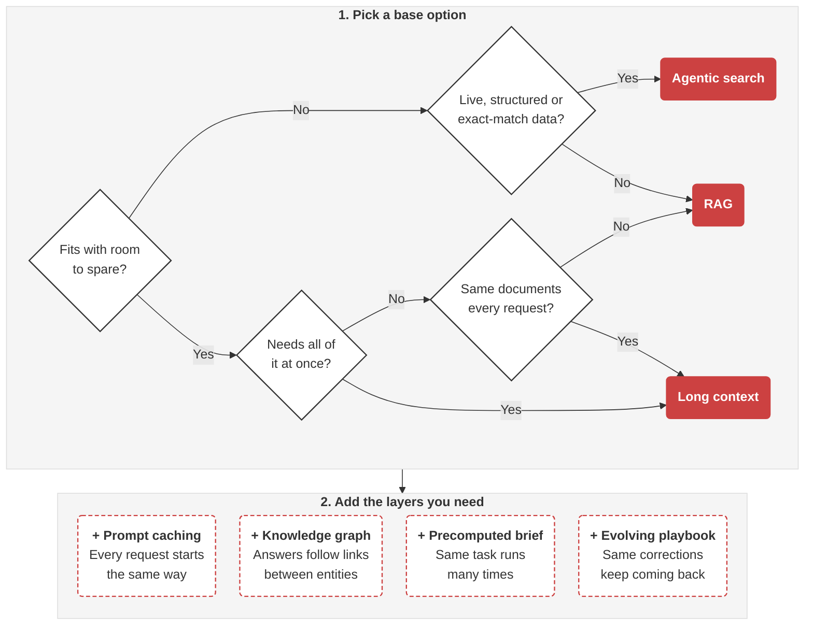

Your AI solution needs your support docs and business information. Feed it too little and it misses the answer. Feed it everything and you can pay more and wait longer.

How the model accesses that data affects cost per query, latency and answer quality. When LLMs had tiny 4K token context windows, RAG was the clear choice. Now that context windows can fit millions of tokens, the choice is less obvious.

<endIntro />

<youtubeEmbed url="https://www.youtube.com/watch?v=UabBYexBD4k" description="Video: Is RAG Still Needed? Choosing the Best Approach for LLMs (11 min)" />

## Option A: Long context

The brute-force approach requires the least infrastructure.

If all the material needed to answer a question fits inside the context window, put it straight into the prompt.

<imageEmbed
  alt="Long context: three whole documents - security requirements, release notes and a design spec - sit inside the prompt with the question, and the whole prompt goes to the LLM on every request"
  size="large"
  showBorder={false}
  figurePrefix="none"
  figure="Long context - the model sees every document in full, and every request pays for all of it"
  src="/uploads/rules/feed-data-to-ai/feed-data-long-context.svg"
/>

This can be useful when the answer isn't in any single document. A question like "*which security requirements never made it into the release?*" may need two or more documents in full, because the answer is the gap between them.

There are caveats. You pay for every token on every request, in money and latency. Position matters too: models can miss information [in the middle](https://arxiv.org/abs/2307.03172) of the context and struggle in [multi-hop conversations](https://arxiv.org/abs/2601.12499).

### Prompt caching - Making long context economical

Prompt caching can make long context cheaper. Caching keys on how a prompt *starts*, not the whole prompt. Put the documents at the front and the user's question at the end. Requests with the same document prefix can reuse the cached copy at a fraction of the price, even when the question changes. Check your provider and model first - the minimum cacheable size, cache lifetime and discount all differ. See [prompt caching](/do-you-follow-best-practices-for-prompt-caching).

Caching cuts cost and latency, not the caveats above. The model still has to find the answer in everything you send.

[CAG (cache-augmented generation)](https://arxiv.org/abs/2412.15605), from Chan et al.'s *Don't Do RAG: When Cache-Augmented Generation is All You Need for Knowledge Tasks*, preloads the whole knowledge base into context, caches it and answers without retrieval. The knowledge base must fit. That is long context plus prompt caching.

## Option B: Retrieval-Augmented Generation (RAG)

RAG means retrieving the relevant material first and passing only that to the model. Retrieval can use keywords, structured queries, graphs, vector similarity or a mix; vector search over embeddings is the most common.

<imageEmbed
  alt="Vector RAG: the question searches a vector database that was indexed ahead of time, the top-k closest chunks go into the prompt with the question, and the prompt goes to the LLM"
  size="large"
  showBorder={false}
  figurePrefix="none"
  figure="Vector RAG - the model only sees the chunks that scored closest to the question"
  src="/uploads/rules/feed-data-to-ai/feed-data-rag.svg"
/>

Best for large collections of unstructured text: support docs, PDFs, policies and transcripts. SSW's [RulesGPT](https://rulesgpt.ssw.com.au) works this way, and so does Cursor - it [chunks your repo and keeps the embeddings in a vector DB](https://cursor.com/blog/secure-codebase-indexing).

**Is RAG dead?** As the **default pipeline** (chunk, embed, retrieve the top matches, then stuff the prompt), it is no longer an obvious choice. As a **capability**, it is very much alive: Claude Projects [switches RAG on](https://support.claude.com/en/articles/11473015-retrieval-augmented-generation-rag-for-projects) when a project outgrows the context window, then backs off when it shrinks.

## Option C: Agentic search

Give an agent tools like `grep`, a search API or read-only SQL access, and let it search, inspect the results and decide what to search next.

This works well when the first results reveal a need for more detail or a different query - much as a person would refine a search. If the data already lives in a database, SQL is often the most direct tool: joins return exact answers that similarity search can only approximate.

There's no separate index to keep in sync, provided the tools read the live source rather than a snapshot or cache.

For shell-based search, the agent needs shell tools, but these can run in a sandbox. Vercel's [just-bash](https://github.com/vercel-labs/just-bash) simulates bash over a virtual filesystem, with `grep`, `find`, `glob` and friends, no child processes, and network access off by default. This lets the model use familiar tools without access to a real shell.

The agent chooses its searches at query time and can use any of the same retrieval tools as RAG. The key difference is that the AI manages its own context rather than relying on a fixed retrieval pipeline.

## Option D: Precompute once, reuse every run

When you run the same task over different inputs, do the expensive reading and reasoning once, before requests arrive. Save the result as part of the task's prompt: a distilled brief, checklist, worked examples or extracted facts. Each run starts from that preparation instead of reading the raw sources again.

<imageEmbed
  alt="Precompute: once, ahead of time, an agent researches the regulations and writes a brief; every run then sends the same brief as a cached prefix, plus one customer's documents, to the LLM"
  size="large"
  showBorder={false}
  figurePrefix="none"
  figure="Precompute - research once, then every run starts from the same brief"
  src="/uploads/rules/feed-data-to-ai/feed-data-precompute.svg"
/>

The pattern goes by a few names:

* [Sleep-time compute](https://arxiv.org/abs/2504.13171) (Lin et al., 2025) - The model reasons over the context before queries arrive. Sharing that work across several related queries about the same context cut the average cost per query by about 2.5×, with gains depending on how predictable the queries are.
* Compiled / optimised prompts - Treat the prompt as a build artefact, optimised against a metric with tools such as [DSPy's GEPA optimizer](https://dspy.ai/api/optimizers/GEPA/overview/).
* [Agent Skills](https://www.anthropic.com/engineering/equipping-agents-for-the-real-world-with-agent-skills) (Anthropic) - Package reusable instructions in a folder with a `SKILL.md` and supporting files. Only the name and description load up front; the body and extra files load when needed. See [Do you use skills to standardize AI workflows?](/ai-agents-with-skills).

This pays off when you have many runs, predictable questions and research that costs more than a single run. The brief goes stale when its sources change. Define when to repeat the research and recompile it, then compare versions with evals before replacing it. See [Do you run evals on your AI features?](/run-evals-on-ai-features).

Precompute saves the reading and reasoning; prompt caching only saves reprocessing an identical prefix. Combine them: put the brief in the cached prefix, with per-customer and per-run input after it.

<boxEmbed
  style="greybox"
  body={<>
    Suppose your team answers the same set of compliance questions for many customers. Whenever the regulations change, an agent researches them and writes a brief for each question: what it asks, which evidence counts and common wrong answers.

    Each customer assessment loads that brief first, as the cached prefix, followed by that customer's documents.
  </>}
  figurePrefix="good"
  figure="Research each question once, then reuse its brief across customer assessments"
/>

To improve the brief from feedback over time, see [Do you let your prompts learn from feedback?](/let-prompts-learn-from-feedback).

## Option E: Knowledge graphs

A knowledge graph stores your data as entities and the relationships between them. Each node can hold a structured summary of one entity, such as a person or a company, with links to related nodes and to the source documents behind it. Instead of isolated chunks of text, the model sees how the facts connect.

<imageEmbed
  alt="Knowledge graph using Northwind data: the Customer node for Alfreds Futterkiste summarises the customer (Berlin, Germany; contact Maria Anders) and links to its source documents and contact. The question follows the path Customer, Orders, a discontinued Product, Supplier and Country Germany, and the path plus its sources go to the LLM"
  size="large"
  showBorder={false}
  figurePrefix="none"
  figure="Knowledge graph - the question follows the links, and the path shows where each fact came from"
  src="/uploads/rules/feed-data-to-ai/feed-data-knowledge-graph.svg"
/>

Graph retrieval is a form of RAG, not a rival to it. You can traverse the graph on its own or combine it with vector search, then pass the connected facts and their sources to the model.

### When does a graph beat vector RAG?

* **Multi-hop questions** - The answer joins facts that no single chunk contains
* **Relationships between entities** - Who bought what, from whom and where, rather than which text sounds similar
* **Explainability** - You can show the path and the sources behind each answer

For example, take [Northwind](https://github.com/microsoft/sql-server-samples/tree/master/samples/databases/northwind-pubs), Microsoft's sample database for a fictional food trader. Imagine its customers, orders, products and suppliers are described across emails, contracts and notes, and you ask: "Which customers bought products from suppliers in Germany that were since discontinued?"

<boxEmbed
  style="greybox"
  body={<>
    Vector search returns the chunks that sound most like the question. They might include supplier notes that mention Germany, a notice about discontinued products and the customer record for Alfreds Futterkiste, because its address is in Berlin, Germany.

    No single chunk says which customer bought which product from which supplier, so the model has to guess the joins. It can miss customers, or include ones whose only link to Germany is their own address.
  </>}
  figurePrefix="bad"
  figure="Vector RAG matches 'Germany' and 'discontinued', not the relationships between them"
/>

<boxEmbed
  style="greybox"
  body={<>
    The graph follows the relationships instead:

    **Customer** → placed → **Order** → contains → **Product** (discontinued) → supplied by → **Supplier** → located in → **Country** (Germany)

    Each customer in the answer comes with its path and links to the source documents, so you can check why it is there.
  </>}
  figurePrefix="good"
  figure="The graph traverses Customer → Order → Product → Supplier → Country and keeps the sources"
/>

### What about GraphRAG and KAG?

[Microsoft GraphRAG](https://microsoft.github.io/graphrag/) builds the graph for you. An LLM extracts entities and relationships from raw text, groups related entities into communities and summarises each community ahead of time ([Edge et al., 2024](https://arxiv.org/abs/2404.16130)). Those summaries help with global questions about a whole corpus, such as "What are the main themes in the dataset?", where standard RAG struggles. That is a different job from following one customer's relationships.

[KAG (knowledge augmented generation)](https://arxiv.org/abs/2409.13731), from the OpenSPG project and used in Ant Group's Q&A services, combines a knowledge graph with vector retrieval so the model can reason over entities and relationships.

### What does a graph cost?

* **Extraction** - LLM calls on every write to find entities and relationships
* **Entity resolution** - "Alfreds Futterkiste" and "Alfreds F." must merge into one node, not two
* **Schema design** - Deciding which entities and relationships matter before you extract them
* **Synchronisation** - Updating the graph whenever its sources change

A visible path makes an answer easier to check, but it doesn't make it correct.

If your data is already relational, you might not need a graph. Northwind itself is a SQL database, so an agent that writes SQL (Option C) can join Customers, Orders, Order Details, Products and Suppliers directly. Graphs pay off when the relationships are spread across unstructured text such as emails, contracts and notes.

For graphs as agent memory, see [the knowledge graphs section of AI agent memory](/ai-agent-memory-systems#knowledge-graphs).

## When should you fine-tune?

Use fine-tuning to change how a model behaves, not what it knows. It suits format and style, and small, focused tasks that run at high volume, such as classification, extraction, routing or returning a consistent output schema. For tasks like these, a small fine-tuned model can be cheaper, faster and as good as a large general model.

Predibase's [LoRA Land](https://arxiv.org/abs/2405.00732) study (2024) fine-tuned 310 models of up to 7B parameters across 31 tasks. The fine-tuned models beat GPT-4 on most narrow tasks such as classification, while GPT-4 kept the lead on broader tasks such as coding and general knowledge (MMLU).

Fine-tuning a small open-weight model is now cheap and quick with tools such as [Hugging Face PEFT](https://huggingface.co/docs/peft/index) or [Unsloth](https://github.com/unslothai/unsloth). They use [LoRA](https://arxiv.org/abs/2106.09685) and other parameter-efficient methods, which train a small set of added weights instead of the whole model. OpenAI is [winding down self-serve fine-tuning](https://developers.openai.com/api/docs/deprecations), so plan on small open-weight models or another provider.

Don't use fine-tuning to teach a model facts that change, such as prices, stock levels or policies. The model can't cite a source for them, and you have to retrain it every time they change. Use RAG, a knowledge graph (Option E) or a precomputed brief (Option D) instead.

Before you fine-tune, you need:

* **An eval set** - Build it first, so you can tell whether fine-tuning helps. See [Do you run evals on your AI features?](/run-evals-on-ai-features).
* **A prompted baseline** - Measure a good prompt with [few-shot examples](/shot-prompts) on the same evals. If it's good enough, you don't need to fine-tune.
* **Enough good examples** - Use real, representative inputs with correct labels. OpenAI's [supervised fine-tuning guide](https://developers.openai.com/api/docs/guides/supervised-fine-tuning) suggests starting with 50 well-crafted examples and adding more only if your evals improve.
* **A retraining plan** - Retrain and re-run your evals when the base model or the task changes.

<boxEmbed
  style="greybox"
  body={<>
    You fine-tune a model on Northwind's product catalogue so it can answer price questions. Then the price of Chai changes.

    The model keeps quoting the old price until you retrain it. It can't cite a source, so users can't tell it's out of date.
  </>}
  figurePrefix="bad"
  figure="Fine-tuning bakes in prices, so the model quotes stale ones until you retrain it"
/>

<boxEmbed
  style="greybox"
  body={<>
    Northwind uses a prompted large model to read every support email, pick one of four queues - Orders, Returns, Shipping or Billing - and return it as JSON.

    You label past emails with the right queue and fine-tune a small model on them. Then you run both models against the same eval set, and switch only if the small model scores as well.
  </>}
  figurePrefix="good"
  figure="Fine-tune a small model for a narrow, high-volume task, and let evals decide whether to switch"
/>

## Which should I use?

These building blocks can be combined. Most RAG vs CAG vs KAG comparisons leave out agentic search and precompute.

Pick a base option first. Three questions settle most cases:

1. **Does the corpus fit with room to spare?** If not, use agentic search for live, structured or exact-match data, and RAG for the rest.
2. **Does the answer need all of it at once?** If so, use long context.
3. **Do the same documents appear in every request?** If so, use long context. If not, use RAG.

Then add the layers you need:

* **Prompt caching** - when every request starts the same way (CAG)
* **Knowledge graph** - when answers follow links between entities (Option E)
* **Precomputed brief** - when the same task runs many times (Option D)
* **[Evolving playbook](/let-prompts-learn-from-feedback)** - when the same corrections keep coming back
* **Fine-tuned small model** - when a narrow task runs at high volume (see fine-tuning above)

**Figure: Choose data access, then add the layers your task needs**

### Using the data-access decision tree

<boxEmbed
  style="greybox"
  body={<>
    [YakShaver](https://yakshaver.ai) turns a screen recording into a PBI. To put that PBI in the right backlog, it must choose from all the projects a user has.

    Apply the decision tree:

    **Q1**: The list of projects and what each one covers is small, so it **fits with room to spare**.

    **Q2**: Picking the best match means comparing all the projects, so it **needs the whole corpus at once**.

    **The result**: Long context. The project list is also identical on every request, so it can be cached.
  </>}
  figurePrefix="good"
  figure="Use long context and prompt caching to choose the right project in YakShaver"
/>

Use the decision tree as a starting point. Combine approaches or use more complex context engineering when you need further optimisation.
