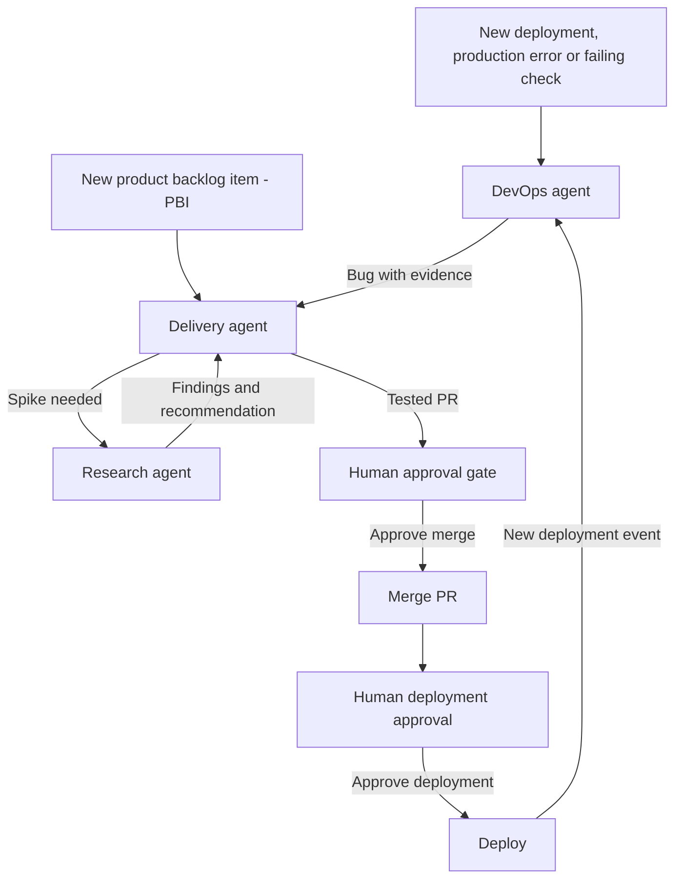

Your AI agent fixes a bug when you ask. Meanwhile, the release dashboard goes stale and a production error sits in a log until a customer complains. Useful work waits for someone to remember to type a prompt.

Give recurring work to **persistent agents that react to events and hand work to each other**. People set the scope and approve consequential actions; they shouldn't have to start every investigation.

<endIntro />

**Figure: Agents start investigations and prepare changes; humans control merges and deployments**

## Give each agent one role

Keep a small team with explicit hand-offs. Three useful roles are:

| Agent | Owns | Hands off |
| --- | --- | --- |
| DevOps / operations | Watches production, checks new deployments and refreshes release dashboards | A bug with reproduction steps, error evidence and the affected release to Delivery |
| Delivery | Takes a ready PBI, implements it, runs checks and prepares a PR | Unresolved questions to Research; a tested change to a human reviewer |
| Research | Investigates a spike when the implementation path is unclear | Findings, evidence and a recommended approach back to Delivery |

A delivery agent might start a **software factory**: an automated workflow that coordinates implementation, testing and review. It can also complete a small task itself. The execution method can change without changing who owns the work.

Persist the work queue, progress and hand-offs so agents can resume after a restart. Persistence does not require one chat or process to stay open forever. See [Microsoft's workflow checkpoint documentation](https://learn.microsoft.com/en-us/agent-framework/workflows/checkpoints) for one implementation.

## Act on a change, not the clock

An hourly poll is a valid trigger. It should check whether something changed before starting agent work. **No change means no new work.**

* **Remember what was handled** - Save the deployment ID, PBI revision or error fingerprint. Seeing the same event twice must not create two bugs or two PRs
* **Make hand-offs actionable** - Include the source event, acceptance criteria, evidence and current owner. Link findings back to the PBI so the next agent can continue without guessing
* **Bound each attempt** - Limit retries, time and spend. Escalate a blocked item to a human instead of passing it between agents indefinitely

[Agentic workflows](/agentic-workflows) can provide the execution layer, with [chained workflows](/chain-agentic-workflows-together) for dependent steps. For event configuration, see [GitHub's workflow trigger documentation](https://docs.github.com/en/actions/reference/workflows-and-actions/events-that-trigger-workflows).

## Make the loop useful

<boxEmbed
  style="greybox"
  body={<>
    Northwind's team asks an agent to investigate only when someone remembers. After release 42, the dashboard still shows release 41. Errors in the Orders service wait in a log until a customer reports that they cannot place an order.
  </>}
  figurePrefix="bad"
  figure="Work waits for a prompt, and customers become the monitoring system"
/>

<boxEmbed
  style="greybox"
  body={<>
    Northwind runs three persistent agents. On its hourly check, DevOps detects release 42, refreshes the release dashboard and finds a new Orders service error. It creates a bug with the failing request and release ID, then hands it to Delivery.

    Delivery starts a fix and prepares a tested PR. Meanwhile, Research picks up a spike for a separate PBI about Supplier lead times and returns its findings to Delivery. A human reviews the fix and approves the merge and deployment.

    On the next poll, there is no new release or error. DevOps records the check and starts no duplicate work.
  </>}
  figurePrefix="good"
  figure="Real changes trigger useful work, with evidence and a human approval gate"
/>

Other useful jobs include nudging stalled PRs, rebasing agent-owned branches and re-running checks after a relevant change. Agents can also identify old worktrees and unused drive files for an approved cleanup. Give each job an explicit scope.

## Keep humans in charge of irreversible actions

Let agents investigate, test and prepare proposals within their permissions. Put **merge, deploy and delete behind a human gate** enforced by the platform or tool permissions. A prompt that says "ask first" is not an approval control. For deployments, see [GitHub's deployment review documentation](https://docs.github.com/en/actions/how-tos/deploy/configure-and-manage-deployments/review-deployments).

Record the triggering event, hand-offs, findings, checks and approval against each PBI. That trail explains why a change happened and separates research evidence from delivery outcomes.

<youtubeEmbed
  url="https://youtu.be/52JX83rGPLc"
  description="Video: ELITE Agentic Engineers Are LEAVING THE LOOP... Here's why (IndyDevDan)"
/>
