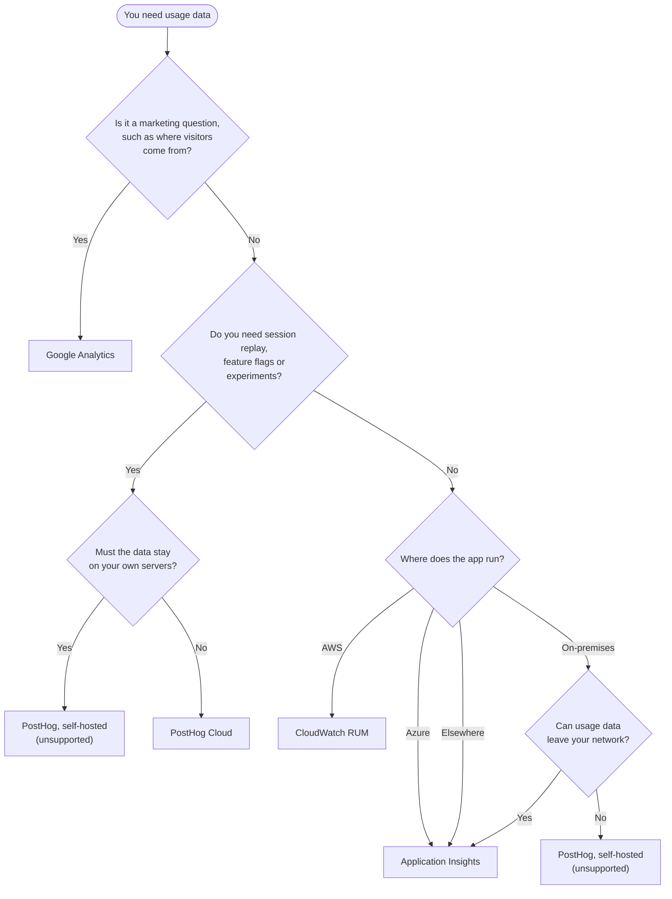

You ship a feature and the Product Owner asks whether anyone uses it. Your logs say the server returned 200. They don't say who clicked the button, where users gave up, or which page nobody opens.

Several good tools answer that question, and each one answers a different version of it. Pick the tool that fits your question and where your app runs, rather than the one the last project used.

<endIntro />

## Which tool should you use?

Work down the tree and stop at the first answer that fits.

**Figure: Choosing a usage analytics tool**

<boxEmbed style="tips" figurePrefix="none" figure="" body={<>

**Tip:** Add [Microsoft Clarity](/website-heatmaps) beside any of these when you want heatmaps of where people click on a public page.

</>} />

## Compare the tools

| Tool | Best for | Session replay | Free tier | AI assistant |
| --- | --- | --- | --- | --- |
| Application Insights | Errors, performance and usage in one place | No | [5 GB a month](https://azure.microsoft.com/en-us/pricing/details/monitor/) | Azure Copilot |
| PostHog | Product analytics, replay, flags and experiments | Yes | [1M events and 5K recordings a month](https://posthog.com/pricing) | PostHog AI |
| Google Analytics | Marketing and where visitors come from | No | [Free](https://marketingplatform.google.com/about/analytics/) | Analytics Intelligence |
| Microsoft Clarity | Heatmaps and session replay | Yes | [Free, no limits](https://clarity.microsoft.com/pricing) | Copilot in Clarity |
| CloudWatch RUM | Web vitals, errors and journeys on AWS | Yes, opt-in | [1M events trial](https://aws.amazon.com/cloudwatch/pricing/) | None |

**Figure: Usage analytics tools compared**

## Which tool do SSW products use?

| Product | Tool | Why |
| --- | --- | --- |
| TinaCMS | PostHog | Product analytics and session replay on TinaCloud |
| SSW Website | Google Analytics and Application Insights | Marketing traffic, plus errors and performance on the server |
| SSW Rules | Application Insights | Errors, performance and page usage in one place |
| TimePro | Application Insights | Errors, performance and page views for the Angular app on Azure |

## Application Insights

Application Insights tracks usage at two levels. Out of the box you get users, sessions and page views. Custom events go further and let you follow users as they move through your app.

<imageEmbed
  alt="Custom events in Application Insights"
  size="large"
  showBorder={false}
  figurePrefix="none"
  figure="Easily track and compare custom events"
  src="/uploads/rules/tools-to-analyse-web-application-usage/custom-events-in-app-insights.jpg"
/>

Add a few lines of code at the hot points of your app to send custom events. See [Application Insights API for custom events and metrics](https://learn.microsoft.com/en-us/azure/azure-monitor/app/api-custom-events-metrics?WT.mc_id=AZ-MVP-33518). If the custom events blade feels limiting, export the data to Power BI with [Using Azure Log Analytics in Power BI](https://learn.microsoft.com/en-us/power-bi/transform-model/log-analytics/desktop-log-analytics-overview?WT.mc_id=DP-MVP-33518).

* ✅ Works for apps hosted anywhere, not only in Azure
* ✅ Usage sits beside the exceptions and slow requests that explain it
* ✅ Includes funnels, user flows, cohorts and retention
* ❌ No session replay or feature flags
* ❌ Sampling can make funnels inaccurate on busy apps

## PostHog

[PostHog](https://posthog.com/) puts product analytics, session replay, feature flags and experiments in one tool. You can count what users did and then watch a recording of how they did it. TinaCMS uses PostHog for TinaCloud.

<imageEmbed
  alt="PostHog funnel showing TinaCloud users moving from account created to project created to first commit"
  size="large"
  showBorder={true}
  figurePrefix="none"
  figure="The TinaCloud onboarding funnel in PostHog shows which step loses new users"
  src="/uploads/rules/tools-to-analyse-web-application-usage/posthog-tinacloud-onboarding-funnel.png"
/>

* ✅ Session replay and feature flags sit beside funnels, so you can see why a step loses people
* ✅ PostHog AI answers questions in plain English and builds the insight for you
* ✅ Open source, and can run without cookies
* ❌ Self-hosting is unsupported, and paid features are cloud only
* ❌ Costs grow with event volume once you pass the free tier

For a worked example, see the PostHog case study in [using an analytics framework to manage exceptions](/do-you-use-an-analytics-framework-to-help-manage-exceptions).

## Google Analytics

Google Analytics shows how visitors find your site, which campaigns bring them and which pages they land on. Use it on public websites where marketing owns the questions. See [collecting and analysing website data with Google Analytics](/use-google-analytics).

* ✅ Free, and marketing teams already know it
* ✅ Connects to Google Ads and Search Console
* ❌ Explorations keep event data for 14 months at most on the standard tier
* ❌ Explorations are sampled on large data sets

## Microsoft Clarity

Microsoft Clarity records sessions and builds heatmaps of where people click and scroll. It is free with no traffic limits, so it suits public pages where you want to see what confuses people. See [tracking website heatmaps](/website-heatmaps).

* ✅ Free forever, with no sampling
* ✅ Copilot in Clarity summarises sessions and heatmaps for you
* ❌ Needs explicit cookie consent in the EEA, UK and Switzerland
* ❌ Keeps recordings for 30 days

## CloudWatch RUM

[CloudWatch RUM](https://docs.aws.amazon.com/AmazonCloudWatch/latest/monitoring/CloudWatch-RUM.html) collects web vitals, JavaScript errors and user journeys from the browser. Use it when the app already runs on AWS and the team works in CloudWatch.

* ✅ Lives next to your other CloudWatch logs, metrics and alarms
* ✅ Session replay is available as an opt-in
* ❌ Charges per event after the trial
* ❌ Keeps data for 30 days unless you copy it to CloudWatch Logs
